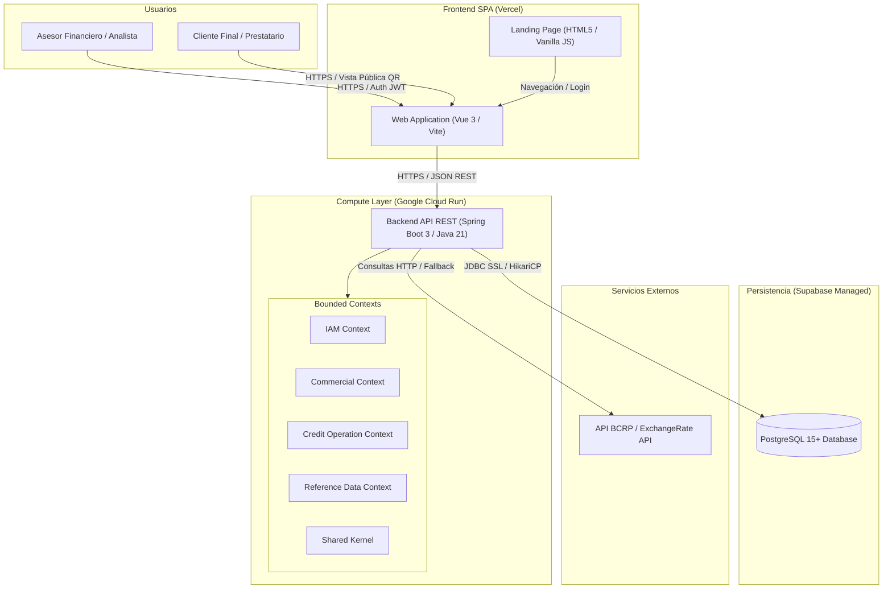
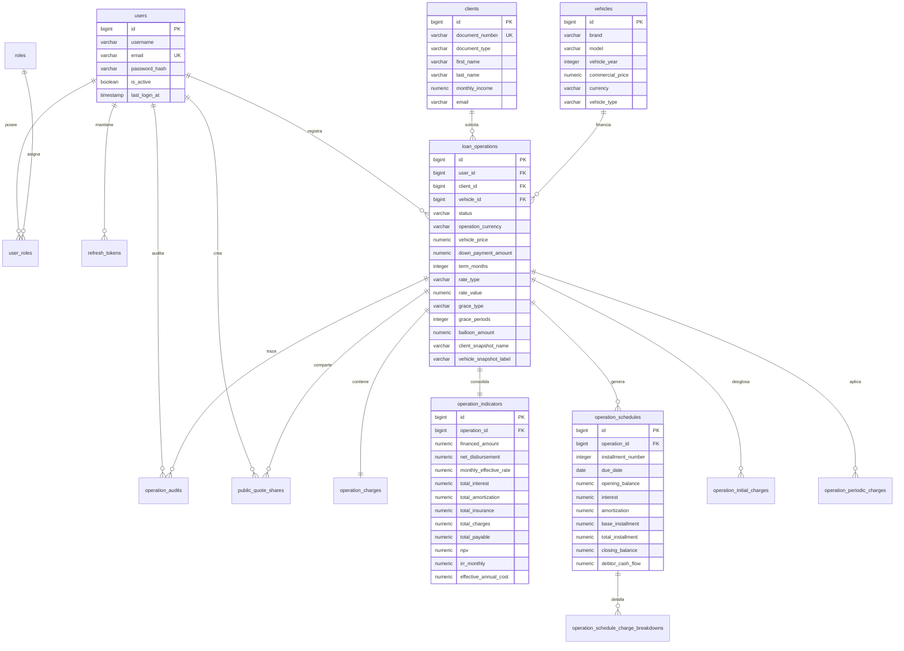

# Capital Cruise - Plataforma Integral de Simulación y Gestión de Créditos Vehiculares

[](https://openjdk.org/projects/jdk/21/)
[](https://spring.io/projects/spring-boot)
[](https://vuejs.org/)
[](https://vitejs.dev/)
[](https://www.postgresql.org/)
[](https://flywaydb.org/)
[](https://www.docker.com/)
[](#)

**Capital Cruise** es una solución web empresarial diseñada para entidades e instituciones financieras orientada a la **simulación, estructuración, auditoría y gestión integral de créditos vehiculares** en el mercado peruano. 

La plataforma estandariza operaciones complejas de matemática financiera bajo el **método francés vencido ordinario**, modelando créditos convencionales y la modalidad de **Compra Inteligente** (financiamiento con cuota final elevada o *balloon*), periodos de gracia total o parcial, esquemas bimoneda (Soles PEN y Dólares USD), desglose riguroso de seguros y cargos, y cálculo estricto de indicadores de rentabilidad y transparencia (**VAN**, **TIR** y **TCEA**) desde la perspectiva del deudor.

---

## 🚀 Live Demo

Explora Capital Cruise a traves de la demo pública.

- **Web Application:** [Open Capital Cruise](https://capital-cruise-phi.vercel.app/)
- **API Documentation:** [Swagger UI](https://capital-cruise.onrender.com/swagger-ui/index.html)

### Credenciales Demo

| Field | Value |
|---|---|
| Email | demo@capitalcruise.com |
| Password | CapitalCruiseDemo2026! |

> Esta demo es para proposito de portafolio
> Por favor usa solo datos ficticios.

---

## Tabla de Contenidos

- [1. Ciclo de Vida del Software y Marco de Negocio](#1-ciclo-de-vida-del-software-y-marco-de-negocio)
  - [1.1 Contexto y Necesidad de Negocio](#11-contexto-y-necesidad-de-negocio)
  - [1.2 Marco Normativo y de Transparencia Financiera](#12-marco-normativo-y-de-transparencia-financiera)
  - [1.3 Alcance y Perfiles de Usuario](#13-alcance-y-perfiles-de-usuario)
- [2. Modelado Matemático y Motor Financiero](#2-modelado-matemático-y-motor-financiero)
  - [2.1 Convenciones Financieras](#21-convenciones-financieras)
  - [2.2 Conversión de Tasas a TEM](#22-conversión-de-tasas-a-tem)
  - [2.3 Modalidad de Compra Inteligente (Cuota Balloon)](#23-modalidad-de-compra-inteligente-cuota-balloon)
  - [2.4 Tratamiento de Periodos de Gracia](#24-tratamiento-de-periodos-de-gracia)
  - [2.5 Seguros, Comisiones y Gastos](#25-seguros-comisiones-y-gastos)
  - [2.6 Flujo de Caja del Deudor, VAN, TIR y TCEA](#26-flujo-de-caja-del-deudor-van-tir-y-tcea)
- [3. Arquitectura del Sistema](#3-arquitectura-del-sistema)
  - [3.1 Arquitectura General (C4 Container)](#31-arquitectura-general-c4-container)
  - [3.2 Backend: Domain-Driven Design (DDD) y CQRS](#32-backend-domain-driven-design-ddd-y-cqrs)
  - [3.3 Frontend: Modular Single Page Application](#33-frontend-modular-single-page-application)
  - [3.4 Protocolo de Comunicación y Seguridad](#34-protocolo-de-comunicación-y-seguridad)
- [4. Modelo de Datos y Persistencia](#4-modelo-de-datos-y-persistencia)
  - [4.1 Diagrama Entidad-Relación (ERD)](#41-diagrama-entidad-relación-erd)
  - [4.2 Diccionario de Tablas Principales](#42-diccionario-de-tablas-principales)
  - [4.3 Inmutabilidad mediante Snapshots](#43-inmutabilidad-mediante-snapshots)
  - [4.4 Versionado con Flyway Migrations](#44-versionado-con-flyway-migrations)
- [5. Catálogo de la API REST](#5-catálogo-de-la-api-rest)
- [6. Estrategia de Calidad y Pruebas](#6-estrategia-de-calidad-y-pruebas)
  - [6.1 Pirámide de Pruebas Implementada](#61-pirámide-de-pruebas-implementada)
  - [6.2 Casos de Validación Financiera](#62-casos-de-validación-financiera)
- [7. Despliegue e Infraestructura Cloud](#7-despliegue-e-infraestructura-cloud)
- [8. Estructura del Repositorio](#8-estructura-del-repositorio)
- [9. Guía de Instalación y Puesta en Marcha](#9-guía-de-instalación-y-puesta-en-marcha)
  - [9.1 Requisitos Previos](#91-requisitos-previos)
  - [9.2 Configuración del Backend](#92-configuración-del-backend)
  - [9.3 Configuración del Frontend](#93-configuración-del-frontend)
  - [9.4 Ejecución con Docker](#94-ejecución-con-docker)

---

## 1. Ciclo de Vida del Software y Marco de Negocio

El ciclo de vida de desarrollo de Capital Cruise se orientó a satisfacer las exigencias técnicas y operativas de las entidades financieras modernas, transformando un proceso de simulación manual propenso a inconsistencias en un flujo trazable, seguro, auditable y parametrizable.

### 1.1 Contexto y Necesidad de Negocio

La cotización de un crédito vehicular involucra múltiples dimensiones financieras: evaluación de valor comercial del vehículo, porcentaje de cuota inicial, plazo en cuotas mensuales, tasas nominales o efectivas con periodicidades diversas, capitalizaciones, amortización ordinaria o diferida, cargos periódicos (seguros de desgravamen y multiriesgo vehicular, comisiones y portes), gastos notariales y registrales iniciales, y opciones de cuota residual (*balloon*).

La plataforma resuelve:
- **Estandarización**: Automatización de fórmulas bajo principios de ingeniería económica eliminando errores humanos de cálculo.
- **Trazabilidad total**: Historial inmutable de operaciones procesadas con auditoría de usuario y fecha.
- **Transparencia hacia el cliente**: Desglose transparente de componentes financieros y generación de enlaces públicos interactivos protegidos por token.

### 1.2 Marco Normativo y de Transparencia Financiera

El diseño operativo y algorítmico del sistema está alineado con la regulación financiera peruana emitida por la Superintendencia de Banca, Seguros y AFP (SBS):
- **Ley General del Sistema Financiero (Ley N.° 26702)**: Estructuración del crédito vehicular como operación activa regulada, con sustento y control contable.
- **Reglamento de Transparencia de Información (Res. SBS N.° 8181-2012)**: Obligación de exponer claramente la **Tasa de Costo Efectivo Anual (TCEA)**, separando la cuota financiera base de los seguros, comisiones y gastos.
- **Reglamento de Conducta de Mercado (Res. SBS N.° 3274-2017)**: Definición del simulador crediticio bajo supuesto de estricto cumplimiento, garantizando que el cronograma proyectado refleje fielmente los costos del financiamiento.
- **Reglamento de Comisiones y Gastos (Res. SBS N.° 3748-2021) y Actualización de Seguros (Res. SBS N.° 3240-2023)**: Discriminación explícita de pólizas de seguro vehicular y desgravamen sobre el saldo insoluto o precio del bien.

### 1.3 Alcance y Perfiles de Usuario

- **Asesores Financieros / Analistas de Crédito**: Usuarios internos autenticados que registran clientes, configuran simulaciones personalizadas, gestionan el catálogo vehicular, auditan cronogramas y emiten cotizaciones.
- **Clientes Finales / Deudores**: Receptores de la oferta crediticia que acceden mediante enlaces públicos temporales o códigos QR compartibles (`/quote/:shareToken`) para visualizar su cronograma de pago detallado sin requerir credenciales internas.

---

## 2. Modelado Matemático y Motor Financiero

El núcleo del sistema reside en el motor financiero (`FinancialCalculationDomainEngine`), el cual aplica las siguientes formulaciones:

### 2.1 Convenciones Financieras
- **Base de tiempo**: Mes comercial de 30 días y año comercial de 360 días ($30/360$).
- **Sistema de amortización**: Método Francés Vencido Ordinario (pagos constantes en periodos ordinarios).
- **Moneda de cálculo**: Bimoneda nativa (PEN / USD) con soporte de tipo de cambio en vivo o manual.

### 2.2 Conversión de Tasas a TEM

Toda tasa introducida en el sistema se homologa a una **Tasa Efectiva Mensual (TEM)**:

1. **Desde Tasa Efectiva (TEA u otro periodo de $d_p$ días)**:
   $$\text{TEM} = (1 + \text{TEP})^{\frac{30}{d_p}} - 1$$
   *(Para TEA con base 360 días: $\text{TEM} = (1 + \text{TEA})^{\frac{30}{360}} - 1 = (1 + \text{TEA})^{\frac{1}{12}} - 1$)*

2. **Desde Tasa Nominal (TNA con capitalización en $d_c$ días)**:
   $$m = \frac{360}{d_c} \quad \implies \quad \text{TEM} = \left( 1 + \frac{\text{TNA}}{m} \right)^{\frac{m}{12}} - 1$$
   *(Para capitalización diaria con $d_c = 1$: $m = 360 \implies \text{TEM} = \left(1 + \frac{\text{TNA}}{360}\right)^{30} - 1$)*

### 2.3 Modalidad de Compra Inteligente (Cuota Balloon)

En la Compra Inteligente, una porción importante del capital ($B$, cuota residual o balón) no se amortiza durante el plazo regular ($n$ meses), sino que se posterga hasta el último periodo:

1. **Valor Presente de la Cuota Balón**:
   $$PV(B) = \frac{B}{(1 + \text{TEM})^n}$$
2. **Capital Amortizable Regular**:
   $$C_{\text{amort}} = C_{\text{principal}} - PV(B)$$
3. **Cuota Base Financiera Ordinaria**:
   $$R = C_{\text{amort}} \times \left[ \frac{\text{TEM} \cdot (1 + \text{TEM})^n}{(1 + \text{TEM})^n - 1} \right]$$
4. **Cuota Final (Mes $n$)**:
   $$\text{CuotaFinal} = R + B$$

### 2.4 Tratamiento de Periodos de Gracia

Configurables al inicio del horizonte de pago ($k \le \text{PeriodosGracia}$):

| Tipo de Gracia | Amortización ($A_k$) | Interés del Periodo ($I_k$) | Cuota Financiera ($R_k$) | Saldo Final ($S_k$) |
|---|---|---|---|---|
| **Gracia Total** | $0$ | $S_{k-1} \times \text{TEM}$ | $0$ | $S_{k-1} + I_k$ *(Capitaliza interés)* |
| **Gracia Parcial** | $0$ | $S_{k-1} \times \text{TEM}$ | $I_k$ | $S_{k-1}$ *(Mantiene saldo)* |
| **Periodo Ordinario** | $R - I_k$ | $S_{k-1} \times \text{TEM}$ | $R$ | $S_{k-1} - A_k$ |

> [!NOTE]
> Al finalizar el periodo de gracia, el sistema recalcula dinámicamente la cuota base $R$ distribuyendo el saldo pendiente actualizado sobre el número de meses restantes ($n_{\text{restantes}} = n - k_{\text{gracia}}$).

### 2.5 Seguros, Comisiones y Gastos

La **Cuota Total del Periodo $k$** consolida los siguientes rubros:
$$\text{CuotaTotal}_k = R_k + \text{SegDesgravamen}_k + \text{SegVehicular}_k + \text{CargosFijos}_k + \text{Balloon}_k$$

- **Seguro de Desgravamen**: Proporcional al saldo vivo al inicio del periodo ($\text{SegDesgravamen}_k = S_{k-1} \times \text{TasaDesg}$).
- **Seguro Vehicular**: Proporcional al valor comercial inicial del activo ($\text{SegVehicular}_k = \text{PrecioVehiculo} \times \text{TasaVeh}$).
- **Cargos Fijos y Periódicos**: Portes mensuales, comisiones y costos de mantenimiento de cuenta.
- **Cargos Iniciales**: Notaría, registros públicos y GPS, clasificados como financiados (sumados al principal) o retenidos del desembolso.

### 2.6 Flujo de Caja del Deudor, VAN, TIR y TCEA

La rentabilidad e impacto financiero se evalúan rigurosamente desde la óptica del cliente (deudor):
- **Momento 0 (Entrada de Fondos)**:
  $$FC_0 = +(\text{PrincipalFinanciado} - \text{CargosInicialesRetenidos})$$
- **Momentos 1 a $n$ (Salidas de Fondos)**:
  $$FC_t = -(\text{CuotaTotal}_t)$$

#### Valor Actual Neto (VAN)
Con una tasa de descuento mensual $k_{\text{desc}}$ configurable:
$$\text{VAN} = FC_0 + \sum_{t=1}^{n} \frac{FC_t}{(1 + k_{\text{desc}})^t}$$

#### Tasa Interna de Retorno (TIR) y TCEA
La TIR mensual ($r$) es la raíz donde $\text{VAN}(r) = 0$, obtenida numéricamente mediante el método de aproximación sucesiva por bisección:
$$0 = FC_0 + \sum_{t=1}^n \frac{FC_t}{(1 + r)^t}$$

Anualización de la TIR para obtener la **Tasa de Costo Efectivo Anual (TCEA)**:
$$\text{TCEA} = (1 + r)^{12} - 1$$

---

## 3. Arquitectura del Sistema

El proyecto está diseñado bajo una arquitectura desacoplada en tres capas (Cliente, Lógica de Negocio y Persistencia), aplicando Domain-Driven Design (DDD) y segregación de responsabilidades.

### 3.1 Arquitectura General (C4 Container)



### 3.2 Backend: Domain-Driven Design (DDD) y CQRS

El backend está estructurado en torno a Bounded Contexts independientes con clara separación entre capas de Aplicación, Dominio, Infraestructura e Interfaces:

```text
com.capitalcruise.platform/
├── commercial/             # Contexto Comercial
│   ├── application/        # Servicios internos (Command y Query)
│   ├── domain/             # Entidades Client y Vehicle, Value Objects
│   ├── infrastructure/     # Repositorios Spring Data JPA
│   └── interfaces/rest/    # Controladores REST (/clients, /vehicles)
├── creditoperation/        # Contexto de Operaciones Crediticias y Motor Financiero
│   ├── application/        # Orquestación de cotizaciones, auditoría y comandos
│   ├── domain/services/    # Motor de cálculo: French, Balloon, Grace, CashFlow, IRR
│   ├── domain/model/       # Agregado LoanOperation, Schedule, Indicators, Charges
│   ├── infrastructure/     # Repositorios JPA de cronogramas y desgloses
│   └── interfaces/rest/    # Controladores REST (/quotes, /operations, /public-quotes)
├── iam/                    # Contexto de Seguridad e Identidad
│   ├── application/        # Comandos de autenticación, gestión de tokens
│   ├── domain/model/       # Agregado User, Roles, RefreshToken
│   ├── infrastructure/     # JWT Provider, Spring Security Filter Chain
│   └── interfaces/rest/    # Controladores (/auth/login, /auth/refresh, /auth/me)
├── referencedata/          # Contexto de Referencia y Ayuda
│   └── interfaces/rest/    # Tipo de cambio BCRP, convenciones y temas de ayuda
└── shared/                 # Kernel compartido
    ├── domain/exceptions/  # Manejador global de excepciones (RestExceptionHandler)
    └── infrastructure/     # Configuración OpenAPI Swagger, CORS, DataSource
```

### 3.3 Frontend: Modular Single Page Application

Desarrollado en **Vue 3** y empaquetado con **Vite**, organizado por módulos funcionales:
- `src/iam/`: Vistas de autenticación y servicios de credenciales.
- `src/clients/`: Formularios de alta, edición y búsqueda reactiva de clientes.
- `src/vehicles/`: Catálogo con visualización de fichas comerciales y filtrado de vehículos.
- `src/loans/`: Formulario interactivo de simulación (`SimulationForm.component.vue`), resultados (`CalculationResults.component.vue`), historial de operaciones con exportación CSV, detalle completo de operación con exportación a PDF, y modal para compartir cotización con código QR.
- `src/public/`: Portal público protegido por token (`PublicQuoteView.page.vue`), layout principal con barra lateral, y centro de soporte/ayuda (`SupportView.page.vue`).
- `src/shared/`: Instancia Axios centralizada con interceptor para refresh token automático, sistema de alertas Toast y componentes de asistencia contextual (`FieldHelp.component.vue`).

### 3.4 Protocolo de Comunicación y Seguridad

- **Cifrado en Tránsito**: Todo el tráfico viaja forzosamente bajo HTTPS / TLS.
- **Autenticación Stateless**: Tokens de acceso **JWT** (JJWT 0.12.6) con tiempo de vida configurable (default: 1 hora) firmados mediante algoritmo HMAC-SHA256.
- **Renovación de Sesión Transparente**: Tokens de refresco (`refresh_tokens`) almacenados como hash SHA-256 en base de datos. Ante un código HTTP `401 Unauthorized`, el frontend solicita automáticamente un nuevo par de tokens sin desconectar al usuario.
- **Control de Acceso Basado en Roles (RBAC)**: Autorización estricta por roles (`ROLE_USER`, `ROLE_ADMIN`).
- **Trazabilidad y Auditoría**: Cada evento en el ciclo de vida de una simulación (`CREATED`, `CALCULATED`, `SAVED`, `DUPLICATED`, `SHARED`) se registra en la tabla `operation_audits`.

---

## 4. Modelo de Datos y Persistencia

### 4.1 Diagrama Entidad-Relación (ERD)



### 4.2 Diccionario de Tablas Principales

1. `users`: Usuarios internos institucionales autorizados.
2. `roles` & `user_roles`: Perfiles de acceso del sistema (RBAC).
3. `refresh_tokens`: Control criptográfico de sesiones activas revocables.
4. `clients`: Directorio de deudores y datos financieros de referencia.
5. `vehicles`: Catálogo de inventario con valorización comercial por divisa.
6. `exchange_rates`: Registro histórico de cotizaciones de tipo de cambio PEN/USD.
7. `loan_operations`: Entidad raíz que modela los parámetros de entrada y estado de la simulación.
8. `operation_charges`: Resumen de tasas de desgravamen, seguro vehicular y portes.
9. `operation_indicators`: Resultados consolidados del motor financiero (VAN, TIR, TCEA, desembolso neto).
10. `operation_schedules`: Detalle línea a línea del cronograma de cuotas (interés, amortización, seguros, flujo).
11. `operation_initial_charges`: Desglose individual de gastos al momento de firma o desembolso.
12. `operation_periodic_charges`: Desglose de comisiones y cargos recurrentes aplicables por rango de cuotas.
13. `operation_schedule_charge_breakdowns`: Desglose específico de cada recargo imputado en una cuota dada.
14. `operation_audits`: Registro inmutable de eventos y acciones sobre las operaciones.
15. `public_quote_shares`: Tokens de compartición pública para acceso de solo lectura del deudor.

### 4.3 Inmutabilidad mediante Snapshots

Para garantizar la integridad y trazabilidad en caso de que un vehículo cambie de precio de lista o un cliente modifique sus datos en el catálogo, la tabla `loan_operations` persiste snapshots inmutables (`client_snapshot_*`, `vehicle_snapshot_*`) en el instante exacto en que se calcula la simulación. Las consultas históricas auditan siempre los valores contractuales del momento del cálculo.

### 4.4 Versionado con Flyway Migrations

La base de datos se administra mediante migraciones versionadas y reproducibles:
- `V1`: Estructura base de autenticación IAM (usuarios, roles, tokens).
- `V3`: Creación de la tabla de clientes (`clients`).
- `V4`: Creación del catálogo vehicular (`vehicles`).
- `V5`: Tabla de tipos de cambio (`exchange_rates`).
- `V6`: Semilla de datos de referencia (convenciones y tasas).
- `V7`: Estructura principal de operaciones crediticias, cargos, indicadores y cronogramas.
- `V8`: Semillas de vehículos y clientes de demostración.
- `V9`: Refactorización de desglose de cargos iniciales, periódicos y compartición pública.

---

## 5. Catálogo de la API REST

Todos los endpoints base se exponen bajo la ruta `/api/v1`:

| Módulo | Endpoint | Método | Descripción | Autenticación |
|---|---|:---:|---|:---:|
| **Salud** | `/api/v1/health` | `GET` | Health check y verificación de conectividad | Pública |
| **Auth** | `/api/v1/auth/login` | `POST` | Autenticación y emisión de access + refresh tokens | Pública |
| **Auth** | `/api/v1/auth/refresh` | `POST` | Renovación de access token mediante refresh token | Pública |
| **Auth** | `/api/v1/auth/logout` | `POST` | Revocación de refresh token y cierre de sesión | Bearer JWT |
| **Auth** | `/api/v1/auth/me` | `GET` | Datos y roles del usuario en sesión | Bearer JWT |
| **Clientes** | `/api/v1/clients` | `GET` | Búsqueda y listado paginado de clientes | Bearer JWT |
| **Clientes** | `/api/v1/clients` | `POST` | Registro de nuevo cliente | Bearer JWT |
| **Clientes** | `/api/v1/clients/{id}` | `GET` | Detalle del cliente por ID | Bearer JWT |
| **Clientes** | `/api/v1/clients/{id}` | `PUT` | Actualización de datos del cliente | Bearer JWT |
| **Vehículos** | `/api/v1/vehicles` | `GET` | Listado del catálogo vehicular activo | Bearer JWT |
| **Vehículos** | `/api/v1/vehicles` | `POST` | Registro de nuevo vehículo en inventario | Bearer JWT |
| **Vehículos** | `/api/v1/vehicles/{id}` | `GET` | Detalle de especificaciones de un vehículo | Bearer JWT |
| **Vehículos** | `/api/v1/vehicles/{id}` | `PUT` | Modificación de datos comerciales de un vehículo | Bearer JWT |
| **Cotizaciones** | `/api/v1/quotes/calculate` | `POST` | Simulación y cálculo en memoria (sin persistir) | Bearer JWT |
| **Operaciones** | `/api/v1/operations` | `GET` | Historial paginado de operaciones con filtros | Bearer JWT |
| **Operaciones** | `/api/v1/operations` | `POST` | Cálculo y persistencia formal de una operación | Bearer JWT |
| **Operaciones** | `/api/v1/operations/{id}` | `GET` | Detalle completo de cronograma e indicadores | Bearer JWT |
| **Operaciones** | `/api/v1/operations/{id}` | `PUT` | Actualización de parámetros y recálculo | Bearer JWT |
| **Operaciones** | `/api/v1/operations/{id}/duplicate` | `POST` | Duplicación de simulación para comparación | Bearer JWT |
| **Operaciones** | `/api/v1/operations/{id}/shares` | `POST` | Generación de token y URL para compartir cotización | Bearer JWT |
| **Referencia** | `/api/v1/reference/exchange-rate` | `GET` | Tipo de cambio referencial (PEN/USD) | Bearer JWT |
| **Referencia** | `/api/v1/reference/help-topics` | `GET` | Contenido de ayuda contextual para formularios | Bearer JWT |
| **Referencia** | `/api/v1/reference/conventions` | `GET` | Parámetros estándar y límites regulatorios | Bearer JWT |
| **Público** | `/api/v1/public-quotes/{token}` | `GET` | Consulta pública de cotización compartida | Pública |

---

## 6. Estrategia de Calidad y Pruebas

El proyecto implementa una exhaustiva suite de pruebas para certificar la estabilidad de la plataforma y la exactitud matemática de los resultados.

### 6.1 Pirámide de Pruebas Implementada

- **Pruebas Unitarias del Motor Financiero (JUnit 5 + AssertJ)**:
  Verificación determinista de fórmulas de conversión de tasas, cálculo de cuotas por método francés, resolución de valor presente de cuotas balloon, amortización cero en periodos de gracia, capitalización de intereses y convergencia numérica de la TIR.
- **Pruebas de Integración (Spring Boot Test + MockMvc + H2)**:
  Pruebas completas sobre los controladores REST de autenticación, clientes, vehículos, operaciones y datos de referencia, evaluando validaciones de entrada, control de transacciones y seguridad de rutas.
- **Pruebas de Configuración y Contratos**:
  Verificación de beans de producción, validación de variables de entorno y compatibilidad de especificaciones OpenAPI.

### 6.2 Casos de Validación Financiera

La precisión de los cálculos fue contrastada contra los tres casos de prueba formales automatizados en `FinancialCalculationDomainEngineTest.java`:

#### Caso 1: Crédito Tradicional sin Gracia
- **Parámetros de Entrada**:
  - Precio del vehículo: $\text{S/ } 80,000.00$
  - Cuota inicial: $20.00\%$ ($\text{S/ } 16,000.00$) $\implies$ Principal financiado: $\text{S/ } 64,000.00$
  - Plazo: $36 \text{ meses}$
  - Tasa: TEA $14.00\%$ (Efectiva Anual) $\implies \text{TEM} \approx 1.0979\%$
  - Periodo de gracia: Sin gracia ($0$) | Cuota Balloon: $\text{S/ } 0.00$
  - Seguro de desgravamen: $0.0300\%$ sobre saldo | Seguro vehicular: $0.0500\%$ sobre precio
  - Portes periódicos: $\text{S/ } 10.00$ | Tasa de descuento: $12.00\%$
- **Resultados Validados**:
  - Cuota base ordinaria: $\text{S/ } 2,161.80$
  - Total intereses: $\text{S/ } 13,824.79$
  - Total seguro desgravamen: $\text{S/ } 377.77$ | Seguro vehicular: $\text{S/ } 1,440.00$
  - Total a pagar: $\text{S/ } 80,002.56$
  - Saldo final en cuota 36: $\text{S/ } 0.00$ (dentro de tolerancia decimal)
  - $\text{TIR Mensual} \approx 1.2618\% \implies \text{TCEA} \approx 16.2373\%$
  - $\text{VAN} \approx -\text{S/ } 3,517.92$

#### Caso 2: Crédito con Gracia Parcial
- **Parámetros de Entrada**:
  - Precio del vehículo: $\text{S/ } 90,000.00$ | Cuota inicial: $25.00\%$ ($\text{S/ } 22,500.00$)
  - Principal financiado: $\text{S/ } 67,500.00$ | Plazo: $48 \text{ meses}$
  - Tasa: TEA $13.00\% \implies \text{TEM} \approx 1.0237\%$
  - Gracia: Parcial durante los $3$ primeros periodos
- **Resultados Validados**:
  - Cuotas 1 a 3: Amortización $= \text{S/ } 0.00$; cuota base $= \text{Interés } (\text{S/ } 690.99)$; saldo se mantiene constante en $\text{S/ } 67,500.00$.
  - Cuotas 4 a 48: Recálculo de cuota base ordinaria a $\text{S/ } 1,879.46$ para amortizar en los 45 meses restantes.
  - Saldo final en cuota 48: $\text{S/ } 0.00$.
  - $\text{TCEA} \approx 15.1707\%$.

#### Caso 3: Compra Inteligente con Cuota Balloon
- **Parámetros de Entrada**:
  - Precio del vehículo: $\$ 30,000.00$ | Cuota inicial: $15.00\%$ ($\$ 4,500.00$)
  - Principal financiado: $\$ 25,500.00$ | Plazo: $36 \text{ meses}$
  - Cuota Balloon: $30.00\%$ del principal ($\$ 7,650.00$)
  - Tasa: TEA $12.00\% \implies \text{TEM} \approx 0.9489\%$
- **Resultados Validados**:
  - Valor presente del Balloon descontado del principal amortizable.
  - Cuotas 1 a 35: Cuota base reducida de $\$ 660.25$.
  - Cuota 36: Cuota base + cuota Balloon ($\$ 8,329.81$).
  - Amortización total cubre íntegramente el saldo al vencimiento final.
  - $\text{TCEA} \approx 13.6461\%$.

---

## 7. Despliegue e Infraestructura Cloud

La solución adopta un modelo Cloud nativo con separación de responsabilidades para alta disponibilidad y baja latencia:

| Componente | Plataforma / Proveedor | Región | Descripción |
|---|---|---|---|
| **Frontend Web** | [Vercel](https://vercel.com) | Edge Global CDN | SPA Vue 3 optimizada para distribución perimetral |
| **Backend API** | [Google Cloud Run](https://cloud.google.com/run) | `southamerica-west1` (Santiago) | Contenedor gestionado serverless autocalable |
| **Base de Datos** | [Supabase](https://supabase.com) | `aws-1-us-east-1` | Instancia gestionada de PostgreSQL 15+ con SSL |

### Enlaces de Producción
- **Aplicación Web**: [https://frontend-web-delta-rose.vercel.app](https://frontend-web-delta-rose.vercel.app)
- **API REST**: [https://backend-capital-cruise-deploy-482841496133.southamerica-west1.run.app](https://backend-capital-cruise-deploy-482841496133.southamerica-west1.run.app)
- **Documentación Swagger UI**: [Swagger UI Interactivo](https://backend-capital-cruise-deploy-482841496133.southamerica-west1.run.app/swagger-ui/index.html)

---

## 8. Estructura del Repositorio

```text
CapitalCruise/
├── backend/                                  # API REST con Spring Boot 3 & Java 21
│   ├── src/main/java/com/capitalcruise/platform/
│   │   ├── commercial/                       # Bounded Context de Clientes y Vehículos
│   │   ├── creditoperation/                  # Bounded Context de Simulación y Motor Financiero
│   │   │   ├── domain/services/              # LoanScheduleCalculator, RateConverter, etc.
│   │   │   └── domain/model/                 # LoanOperation y Value Objects
│   │   ├── iam/                              # Bounded Context de Seguridad y Autenticación JWT
│   │   ├── referencedata/                    # Bounded Context de Tipos de Cambio y Soporte
│   │   └── shared/                           # Filtros, Swagger y Handlers de Excepciones
│   ├── src/main/resources/
│   │   ├── db/migration/                     # Scripts de migración Flyway (V1 a V9)
│   │   ├── application.properties            # Propiedades comunes
│   │   ├── application-dev.properties        # Perfil local con H2
│   │   └── application-prod.properties       # Perfil cloud con PostgreSQL (Supabase)
│   ├── src/test/java/                        # Suite de 17 clases de pruebas automatizadas
│   ├── Dockerfile                            # Empaquetado multi-stage (Maven + Eclipse Temurin)
│   └── pom.xml                               # Configuración de dependencias Maven
│
├── frontend-web/                             # Aplicación Single Page Application (Vue 3 + Vite)
│   ├── public/                               # Favicon y assets estáticos
│   ├── src/
│   │   ├── clients/                          # Módulo de gestión de clientes
│   │   ├── iam/                              # Módulo de autenticación (Login, JWT token storage)
│   │   ├── loans/                            # Módulo de simulaciones, cronogramas y reportes
│   │   ├── public/                           # Vistas compartidas (/quote/:token) y soporte (/support)
│   │   ├── shared/                           # Servicios HTTP, utilidades de formato, Tooltips
│   │   ├── vehicles/                         # Módulo de inventario vehicular
│   │   ├── App.vue                           # Componente raíz
│   │   ├── main.js                           # Punto de entrada de la aplicación
│   │   └── router.js                         # Configuración central de rutas y navegación
│   ├── .env.development                      # Variables de entorno locales
│   ├── .env.production                       # Variables de entorno para despliegue en Vercel
│   ├── package.json                          # Scripts y dependencias de NPM
│   └── vite.config.js                        # Configuración del bundler Vite
│
└── README.md                                 # Documentación técnica integral del proyecto
```

---

## 9. Guía de Instalación y Puesta en Marcha

### 9.1 Requisitos Previos

- **Java Development Kit (JDK)**: Versión 21 o superior
- **Apache Maven**: Versión 3.9 o superior
- **Node.js**: Versión 22.0.0 o superior
- **pnpm**: Gestor de paquetes recomendado (`npm install -g pnpm`)
- *(Opcional)* **Docker**: Para ejecución mediante contenedores

---

### 9.2 Configuración del Backend

1. **Ingresar al directorio del backend**:
   ```bash
   cd backend
   ```

2. **Ejecución en Perfil de Desarrollo (H2 in-memory)**:
   Por defecto, el backend arranca con base de datos en memoria H2 preconfigurada con modo PostgreSQL:
   ```bash
   mvn spring-boot:run
   ```

3. **Ejecución en Perfil con Base de Datos PostgreSQL**:
   Establezca las siguientes variables de entorno antes de ejecutar:
   ```bash
   export SPRING_PROFILES_ACTIVE=prod
   export DATABASE_URL=jdbc:postgresql://<HOST>:<PORT>/<DATABASE>?sslmode=require
   export SUPABASE_DB_USERNAME=<USUARIO>
   export SUPABASE_DB_PASSWORD=<CONTRASEÑA>
   export JWT_SECRET=ClaveSecretaConAlMenosTreintaYDosCaracteresHexadecimales
   export JWT_EXPIRATION_MILLIS=3600000

   mvn spring-boot:run
   ```

4. **Ejecutar Suite de Pruebas Automatizadas**:
   ```bash
   mvn test
   ```

5. **Compilar y Generar JAR de Producción**:
   ```bash
   mvn clean package
   ```

---

### 9.3 Configuración del Frontend

1. **Ingresar al directorio del frontend**:
   ```bash
   cd frontend-web
   ```

2. **Instalar dependencias**:
   ```bash
   pnpm install
   ```

3. **Configurar variables de entorno (`.env.local`)**:
   ```env
   VITE_API_BASE=http://localhost:8080
   VITE_DEFAULT_LOGIN_USER=admin@capitalcruise.local
   VITE_PUBLIC_FRONTEND_URL=http://localhost:5173
   ```

4. **Iniciar servidor de desarrollo**:
   ```bash
   pnpm dev
   ```
   La aplicación estará accesible en: `http://localhost:5173`

5. **Compilar para producción**:
   ```bash
   pnpm build
   pnpm preview
   ```

---

### 9.4 Ejecución con Docker

El proyecto incluye un `Dockerfile` multi-stage optimizado que compila y empaqueta el backend en una imagen ligera basada en Ubuntu Jammy y Eclipse Temurin JRE 21:

1. **Construir la imagen**:
   ```bash
   cd backend
   docker build -t capital-cruise-backend:latest .
   ```

2. **Ejecutar el contenedor**:
   ```bash
   docker run -d \
     -p 8080:8080 \
     -e SPRING_PROFILES_ACTIVE=dev \
     -e JWT_SECRET=DevSecretKeyForCapitalCruiseJwtMustHaveAtLeastThirtyTwoCharacters \
     --name capital-cruise-api \
     capital-cruise-backend:latest
   ```

3. **Verificar el estado del servicio**:
   ```bash
   curl http://localhost:8080/api/v1/health
   ```
